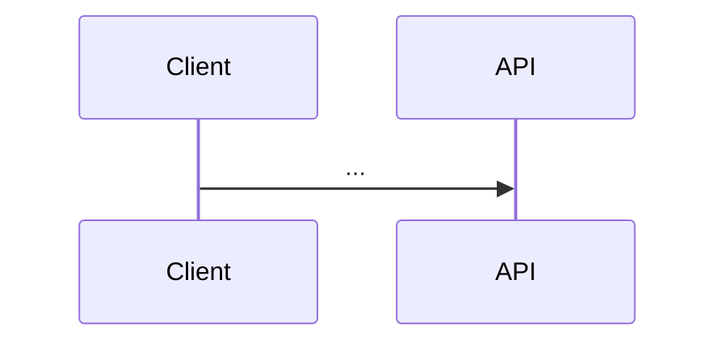
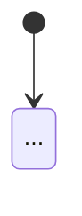

# <Feature name> — technical notes

<!-- Only Overview is required. Add other sections as needed; delete empty ones. -->

## Overview
- `<path/to/module>` — <role>

## Flow

## Integrations
### <System>
- Endpoint: ...
- Timeout: ... (<SCENARIO-ID>)
- Retries / idempotency: ...
- Errors: ...

## State

## Data
- <Entity / invariant> (<SCENARIO-ID>)

## Decisions
- <Decision and why>

## Known limitations
- ...
