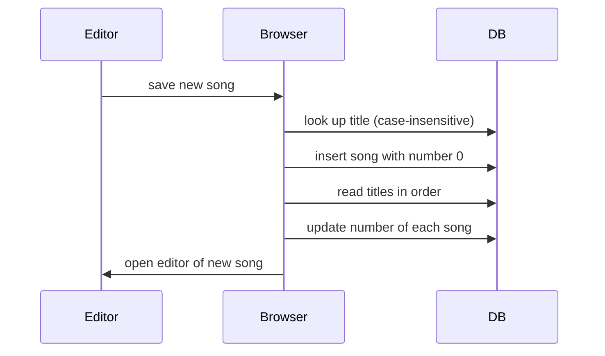

# Song management — technical notes

## Overview
- `src/widgets/admin-song-list/ui/admin-song-list.tsx` — paged list and search
- `src/widgets/edit-song-view/ui/edit-song-view.tsx` — add and edit form, preview
- `src/features/delete-song/ui/delete-song-flow.tsx` — two-step deletion
- `src/entities/song/api/reorder-songs.ts` — renumbering

## Flow

## Data
- Song numbers are 1..N in title order; they are recomputed after adding and after deleting, one update per song (ADM-EDIT-007, ADM-EDIT-019)
- A new song is stored with number 0 until renumbering finishes (ADM-EDIT-007)
- The list reads 20 rows per request; a whole-number search reads one row by number (ADM-EDIT-001, ADM-EDIT-002, ADM-EDIT-004)

## Decisions
- A new song's form has no page before the next publish; the shared not-found page shows "Сторінка ще не готова" for it (ADM-EDIT-027, see `catalog/view/view.tech.md`)
- Writes go from the browser straight to the database using the editor's session; there is no server of our own

## Known limitations
- **Bug** — renaming does not renumber (`handleSaveConfirm` in `src/widgets/edit-song-view/ui/edit-song-view.tsx:176-194`). Violates ADM-SONG-I5
- **Bug** — renumbering sends one update per song and ignores errors; an interruption leaves numbers partly updated and a new song at number 0 (`src/entities/song/api/reorder-songs.ts:9-18`). Violates ADM-SONG-I5
- **Bug** — renaming to an existing title is allowed; the uniqueness check runs only on add. Violates ADM-SONG-I2
- **Bug** — the uniqueness check uses a pattern match, so "%" or "_" in a title match other songs, and a check that finds several matches is ignored (`edit-song-view.tsx:202-206`). Violates ADM-SONG-I2
- **Bug** — saving changes stores the title with surrounding spaces (`edit-song-view.tsx:182`). Violates ADM-SONG-I1
