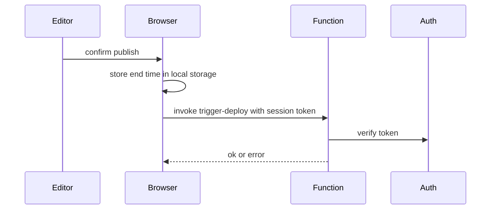

# Publish changes — technical notes

## Overview
- `src/features/trigger-deploy/ui/trigger-deploy-button.tsx` — button, dialogs, countdown
- `supabase/functions/trigger-deploy` — edge function that starts the rebuild

## Flow

## Integrations
### trigger-deploy function
- Rejects requests without a valid session with status 401 (ADM-PUBLISH-007)
- Errors from the call end the in-progress state and clear the stored end time (ADM-PUBLISH-007)

## State
- The end time (now + 5 minutes) is kept in local storage under `deploy_active_until`; a page load before that time resumes the countdown (ADM-PUBLISH-004, ADM-PUBLISH-005, ADM-PUBLISH-006)

## Known limitations
- The 5 minutes are a fixed estimate; the real build status is not read (decided: ADM-PUBLISH Out of scope)
